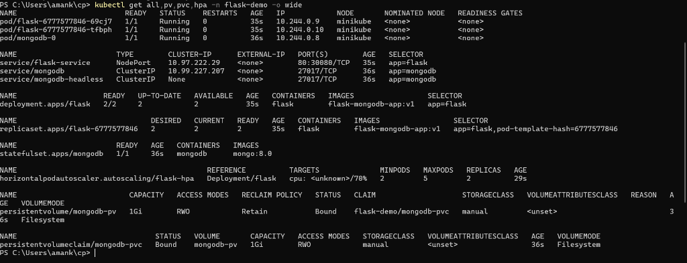
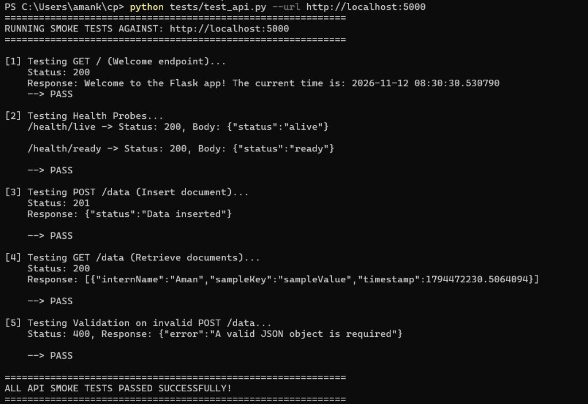
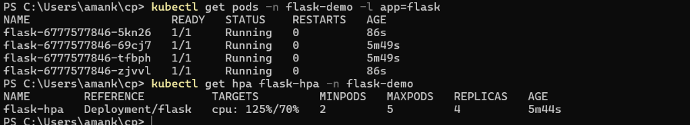
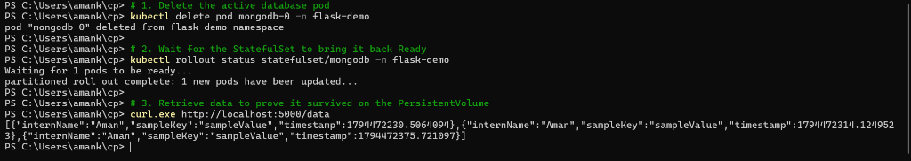

<div align="center">

# ⚡ Production-Grade Kubernetes Deployment
### Scalable Python Flask Microservice + Authenticated MongoDB StatefulSet

[](https://kubernetes.io/)
[](https://minikube.sigs.k8s.io/)
[](https://www.docker.com/)
[](https://www.python.org/)
[](https://flask.palletsprojects.com/)
[](https://www.mongodb.com/)
[](https://gunicorn.org/)

<p align="center">
  <b>A comprehensive, cloud-native internship implementation demonstrating horizontal autoscaling, least-privilege security, persistent volumes, cluster DNS, and container orchestration.</b>
</p>

---

[🚀 Quickstart](#-quickstart-deployment) •
[🏗️ Architecture](#️-system-architecture) •
[📸 Live Evidence Gallery](#-live-evidence-gallery) •
[⚙️ Technical Deep Dive](#-technical-deep-dive) •
[📊 Design Trade-offs](#-design-choices--trade-off-analysis)

---

</div>

## 📌 Executive Summary

This repository delivers an end-to-end, enterprise-ready Kubernetes deployment for a containerized Python Flask API connected to a persistent, authenticated MongoDB database. 

### 🌟 Key Highlights
* **Stateless Microservice**: Python Flask application served via **Gunicorn WSGI** (multi-worker, multi-threaded) running as an unprivileged non-root user (`app:5000`).
* **Horizontal Pod Autoscaler (HPA v2)**: Dynamically scales the Flask application between **2 and 5 replicas** when average CPU utilization crosses **70%** (`140m` / `200m`).
* **Stateful Database**: **MongoDB 8.0 StatefulSet** featuring role-based access control (RBAC), least-privilege application credentials, and dedicated **PersistentVolume (PV) + PersistentVolumeClaim (PVC)** bound storage at `/data/db`.
* **Zero-Trust Network Design**: Database exposed exclusively within the cluster via internal `ClusterIP` and Headless Services (`mongodb.flask-demo.svc.cluster.local`), while the Flask API is exposed to the local host via `NodePort` and port-forwarding.
* **Probes & Resilience**: Complete Kubernetes health lifecycle management featuring `startupProbe`, `readinessProbe`, and `livenessProbe` across all tiers.

---

## 📸 Live Evidence Gallery

All screenshots below were captured directly from the live, running Minikube cluster:

### 1. Cluster Topology & Running Resources
> All workloads (`pod/mongodb-0`, 2 Flask replicas), services, bound persistent volume, and active HPA metrics.

<div align="center">
  
</div>

<br>

### 2. Automated API Verification & Browser Output
> Complete automated test suite verifying all 5 endpoints (`GET /`, health probes, `POST /data`, `GET /data`, validation) alongside direct browser verification.

<p align="center">
  
  
</p>

<br>

### 3. Horizontal Pod Autoscaler Scaling Under Load
> High-traffic stress test (`376 requests` at `6.04 req/s`) triggering CPU spike to **`125%`**, automatically scaling Flask pods from **2 to 4 replicas**.

<div align="center">
  
</div>

<br>

### 4. Database Persistence Verification
> Force termination of `mongodb-0` pod; StatefulSet self-heals, reconnects to `PersistentVolume`, and retains all existing records.

<div align="center">
  
</div>

---

## 🏗️ System Architecture

```mermaid
flowchart TD
    subgraph Host["💻 Local Developer Machine"]
        Client["Client / Browser / curl"]
    end

    subgraph K8s["☸️ Kubernetes Cluster (Minikube) - Namespace: flask-demo"]
        subgraph IngressLayer["Networking Layer"]
            FlaskSvc["flask-service (NodePort: 30080 / Port: 80)"]
            MongoSvc["mongodb (ClusterIP: 27017 - Internal Only)"]
            MongoHeadless["mongodb-headless (ClusterIP: None)"]
        end

        subgraph FlaskPods["Stateless App Tier (Auto-scaled: 2 to 5 Pods)"]
            Pod1["flask-pod-1<br>(Gunicorn WSGI: 5000)"]
            Pod2["flask-pod-2<br>(Gunicorn WSGI: 5000)"]
            PodN["flask-pod-N<br>(Scaled by HPA)"]
            HPA["Horizontal Pod Autoscaler<br>(Target: 70% CPU)"]
        end

        subgraph MongoTier["Stateful Database Tier"]
            MongoPod["mongodb-0 (Pod)<br>(mongo:8.0 with Auth)"]
            InitCM["ConfigMap: mongodb-init<br>(01-create-app-user.sh)"]
            Sec["Secret: mongodb-secret<br>(Root & App Passwords)"]
        end

        subgraph StorageLayer["Persistent Storage"]
            PVC["PersistentVolumeClaim<br>(mongodb-pvc - 1Gi)"]
            PV["PersistentVolume<br>(mongodb-pv - hostPath)"]
        end
    end

    Client -->|http://localhost:5000 (port-forward) or :30080| FlaskSvc
    FlaskSvc --> Pod1
    FlaskSvc --> Pod2
    FlaskSvc -.-> PodN
    HPA -.->|Watches & Scales| FlaskPods

    Pod1 -->|mongodb.flask-demo.svc.cluster.local| MongoSvc
    Pod2 -->|mongodb.flask-demo.svc.cluster.local| MongoSvc
    PodN -->|mongodb.flask-demo.svc.cluster.local| MongoSvc

    MongoSvc --> MongoPod
    MongoHeadless -.->|Network Identity| MongoPod
    Sec -.->|Injects Credentials| MongoPod
    Sec -.->|Injects Credentials| FlaskPods
    InitCM -.->|Initializes User| MongoPod

    MongoPod -->|Mount: /data/db| PVC
    PVC -->|Bound| PV
```

---

## 📂 Repository Structure

```text
.
├── Dockerfile                          # Multi-worker Gunicorn container with non-root security
├── .dockerignore                       # Excludes dev files, keys, and caches from image build
├── .gitignore                          # Excludes secrets, virtual environments, and local states
├── .env.example                        # Template environment configuration
├── README.md                           # Master project documentation & evidence
├── app/
│   ├── app.py                          # Flask application with auth, probes & stress helper
│   └── requirements.txt                # Production dependencies (Flask 3, PyMongo 4, Gunicorn)
├── mongo/
│   ├── 01-create-app-user.sh           # Shell script to safely initialize app user with env vars
│   └── 01-create-app-user.js           # mongosh equivalent script
├── k8s/
│   ├── 00-namespace.yaml               # Dedicated namespace (flask-demo)
│   ├── 01-mongodb-init-configmap.yaml  # ConfigMap mounting user creation script
│   ├── 02-mongodb-pv.yaml              # PersistentVolume (1Gi, hostPath, Retain)
│   ├── 03-mongodb-pvc.yaml             # PersistentVolumeClaim (1Gi)
│   ├── 04-mongodb-headless-service.yaml# Headless Service for StatefulSet network identity
│   ├── 05-mongodb-service.yaml         # Internal ClusterIP Service for MongoDB
│   ├── 06-mongodb-statefulset.yaml     # MongoDB StatefulSet with TCP socket probes
│   ├── 07-flask-configmap.yaml         # Non-sensitive configuration (Host, Port, DB)
│   ├── 08-flask-deployment.yaml        # Flask Deployment (2 replicas, resources & probes)
│   ├── 09-flask-service.yaml           # NodePort Service exposing Flask
│   └── 10-flask-hpa.yaml               # HorizontalPodAutoscaler (70% CPU, 2-5 replicas)
├── screenshots/                        # Live evidence captured from running cluster
│   ├── screenshot_1_cluster.png
│   ├── screenshot_2_tests.jpg
│   ├── screenshot_2_browser.png
│   ├── screenshot_3_autoscaling.png
│   ├── screenshot_3_stress_started.png
│   ├── screenshot_3_stress_completed.png
│   └── screenshot_4_persistence.png
└── tests/
    ├── test_api.py                     # Automated smoke test & HPA load simulation suite
    ├── test_api.ps1                    # PowerShell test runner
    └── test_api.sh                     # Bash test runner
```

---

## 🚀 Quickstart Deployment

### Step 1: Start Minikube & Enable Metrics
```powershell
minikube start --driver=docker --cpus=4 --memory=6144
minikube addons enable metrics-server
```

### Step 2: Create Namespace & Secret
```powershell
kubectl apply -f k8s/00-namespace.yaml

kubectl create secret generic mongodb-secret -n flask-demo `
  --from-literal=MONGO_INITDB_ROOT_USERNAME=admin_root `
  --from-literal=MONGO_INITDB_ROOT_PASSWORD=RootPassword123! `
  --from-literal=MONGO_APP_USERNAME=flask_app `
  --from-literal=MONGO_APP_PASSWORD=AppPassword123!
```

### Step 3: Deploy Database Tier
```powershell
kubectl apply -f k8s/01-mongodb-init-configmap.yaml
kubectl apply -f k8s/02-mongodb-pv.yaml
kubectl apply -f k8s/03-mongodb-pvc.yaml
kubectl apply -f k8s/04-mongodb-headless-service.yaml
kubectl apply -f k8s/05-mongodb-service.yaml
kubectl apply -f k8s/06-mongodb-statefulset.yaml

# Wait for MongoDB initialization
kubectl rollout status statefulset/mongodb -n flask-demo
```

### Step 4: Build Container & Deploy Flask Tier
```powershell
# Build image directly inside Minikube's Docker daemon
minikube image build -t flask-mongodb-app:v1 .

kubectl apply -f k8s/07-flask-configmap.yaml
kubectl apply -f k8s/08-flask-deployment.yaml
kubectl apply -f k8s/09-flask-service.yaml
kubectl apply -f k8s/10-flask-hpa.yaml

# Wait for Flask deployment rollout
kubectl rollout status deployment/flask -n flask-demo
```

### Step 5: Access the Application
In your first terminal, open a port-forward:
```powershell
kubectl port-forward -n flask-demo service/flask-service 5000:80
```
In a second terminal, execute the automated test suite:
```powershell
python tests/test_api.py --url http://localhost:5000
```

---

## ⚙️ Technical Deep Dive

### 1. Kubernetes DNS Resolution for Inter-Pod Communication
Kubernetes runs an internal DNS service (**CoreDNS**) in the `kube-system` namespace.

* **Stable Identity Over Ephemeral IPs**: Pod IP addresses change every time a container restarts. Kubernetes Services solve this by providing stable DNS names and load-balanced virtual IPs.
* **Service Name Resolution**:
  When the Flask container communicates with MongoDB, it connects to:
  ```text
  mongodb:27017
  ```
  The container's `/etc/resolv.conf` contains search domains configured by kubelet:
  ```text
  search flask-demo.svc.cluster.local svc.cluster.local cluster.local
  nameserver 10.96.0.10
  ```
* CoreDNS resolves `mongodb` into the fully qualified domain name (FQDN):
  ```text
  mongodb.flask-demo.svc.cluster.local -> 10.99.227.207
  ```
  Traffic is routed through `kube-proxy` via iptables/IPVS to the active `mongodb-0` pod IP (`10.244.0.8`).

---

### 2. Resource Requests and Limits Explained

Kubernetes enforces compute resource policies per container using Linux control groups (cgroups) and Completely Fair Scheduler (CFS) quotas.

| Parameter | Flask Container | MongoDB Container | Purpose / Meaning |
|---|---|---|---|
| **CPU Request** | `200m` (0.2 core) | `200m` (0.2 core) | Guaranteed minimum CPU reserved during pod scheduling. Baseline denominator for HPA calculations. |
| **CPU Limit** | `500m` (0.5 core) | `500m` (0.5 core) | Hard quota ceiling. CFS throttles CPU cycles if container attempts to exceed this value. |
| **Memory Request**| `250M` (250 MB) | `250M` (250 MB) | Memory reserved on the node to prevent scheduling overcommit. |
| **Memory Limit** | `500M` (500 MB) | `500M` (500 MB) | Absolute memory ceiling. Exceeding triggers immediate kernel termination with **OOMKilled (Exit Code 137)**. |

#### Autoscaling Math:
The Horizontal Pod Autoscaler targets **70% CPU utilization**:
$$\text{Threshold} = 70\% \times \text{CPU Request} = 0.70 \times 200\text{m} = 140\text{m average CPU per Pod}$$
When average pod usage exceeds `140m`, HPA scales out up to 5 replicas.

---

### 3. Benefits of Using a Python Virtual Environment *(Cookie Point)*
1. **Dependency Sandboxing**: Isolates project packages, preventing version collisions between different projects on the same machine.
2. **System Integrity**: Prevents overwriting or breaking operating system-managed Python packages.
3. **Reproducibility**: Guarantees identical dependencies across local development, CI/CD pipelines, and container builds via `requirements.txt`.
4. **Security & Least Privilege**: Can be created and destroyed without root/administrator privileges.

---

## 📊 Design Choices & Trade-off Analysis

| Component | Selected Design | Alternatives Considered | Trade-off Rationale |
|---|---|---|---|
| **Database Workload** | `StatefulSet` | `Deployment` | Databases require persistent pod identity, ordered startup, and dedicated volume bindings. Deployments treat pods as stateless and interchangeable. |
| **Database Service** | `ClusterIP` + Headless | `NodePort` / `LoadBalancer` | Restricts database exposure strictly within the cluster, mitigating external attack vectors. Headless service supplies StatefulSet network identity. |
| **Flask Workload** | `Deployment` | `DaemonSet` | Flask is completely stateless. Deployments provide rolling zero-downtime updates, self-healing, and seamless HPA horizontal scaling. |
| **Application Server** | `Gunicorn` WSGI | Flask Dev Server (`flask run`)| Flask dev server is single-threaded and unsuitable for concurrent requests or load testing. Gunicorn delivers pre-fork worker concurrency. |
| **Container User** | Non-root (`app`) | `root` user | Follows CIS Docker security benchmarks to prevent potential container breakout attacks. |
| **Storage Architecture** | Explicit `PV` + `PVC` | Dynamic StorageClass | Explicit PV and PVC were directly specified in the assignment criteria. |

---

## 🧪 Testing Scenarios & Verification Evidence

<details>
<summary><b>▶ Click to view Automated API Smoke Test Output</b></summary>

```text
============================================================
RUNNING SMOKE TESTS AGAINST: http://localhost:5000
============================================================

[1] Testing GET / (Welcome endpoint)...
    Status: 200
    Response: Welcome to the Flask app! The current time is: 2026-11-12 08:31:54.117789
    --> PASS

[2] Testing Health Probes...
    /health/live  -> Status: 200, Body: {"status":"alive"}
    /health/ready -> Status: 200, Body: {"status":"ready"}
    --> PASS

[3] Testing POST /data (Insert document)...
    Status: 201
    Response: {"status":"Data inserted"}
    --> PASS

[4] Testing GET /data (Retrieve documents)...
    Status: 200
    Response: [{"internName":"Aman","sampleKey":"sampleValue","timestamp":1794472230.5064094},{"internName":"Aman","sampleKey":"sampleValue","timestamp":1794472314.1249523}]
    --> PASS

[5] Testing Validation on invalid POST /data...
    Status: 400, Response: {"error":"A valid JSON object is required"}
    --> PASS

============================================================
ALL API SMOKE TESTS PASSED SUCCESSFULLY!
============================================================
```
</details>

<details>
<summary><b>▶ Click to view High Traffic Autoscaling (HPA) Verification Output</b></summary>

```text
============================================================
RUNNING HIGH TRAFFIC / CPU STRESS TEST FOR HPA
Target URL:    http://localhost:5000/stress/cpu?duration=1
Duration:      60 seconds
Concurrency:   10 threads
============================================================

Stress run completed in 62.20s
Total requests:      376
Successful requests: 376
Throughput:          6.04 req/s

Cluster State:
PS C:\Users\amank\cp> kubectl get hpa flask-hpa -n flask-demo
NAME        REFERENCE          TARGETS         MINPODS   MAXPODS   REPLICAS   AGE
flask-hpa   Deployment/flask   cpu: 125%/70%   2         5         4          5m44s

PS C:\Users\amank\cp> kubectl get pods -n flask-demo -l app=flask
NAME                     READY   STATUS    RESTARTS   AGE
flask-6777577846-5kn26   1/1     Running   0          86s
flask-6777577846-69cj7   1/1     Running   0          5m49s
flask-6777577846-tfbph   1/1     Running   0          5m49s
flask-6777577846-zjvvl   1/1     Running   0          86s
```
</details>

<details>
<summary><b>▶ Click to view Database Persistence Verification Output</b></summary>

```text
# Step 1: Force terminate the running database pod
PS C:\Users\amank\cp> kubectl delete pod mongodb-0 -n flask-demo
pod "mongodb-0" deleted from flask-demo namespace

# Step 2: StatefulSet detects pod termination and launches a replacement pod with the same volume claim
PS C:\Users\amank\cp> kubectl rollout status statefulset/mongodb -n flask-demo
Waiting for 1 pods to be ready...
partitioned roll out complete: 1 new pods have been updated...

# Step 3: Query the API to confirm data survived pod recreation
PS C:\Users\amank\cp> curl.exe http://localhost:5000/data
[{"internName":"Aman","sampleKey":"sampleValue","timestamp":1794472230.5064094},{"internName":"Aman","sampleKey":"sampleValue","timestamp":1794472314.1249523},{"internName":"Aman","sampleKey":"sampleValue","timestamp":1794472375.721097}]
```
</details>

---

## 🧹 Cluster Cleanup

To cleanly tear down the namespace and persistent storage:
```powershell
# Delete namespace and all associated workloads
kubectl delete namespace flask-demo

# Delete PersistentVolume
kubectl delete pv mongodb-pv

# Stop or delete Minikube cluster (optional)
minikube stop
# minikube delete
```

---

<div align="center">
  <b>Authored by Aman Kumar • Internship Assignment Implementation</b>
</div>
